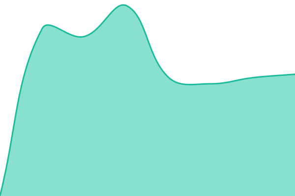

# [📈 Live Status](https://status.obrahaus.com): <!--live status--> **🟩 All systems operational**

This repository contains the open-source uptime monitor and status page for [ObraHaus IT Solutions](https://obrahaus.com), powered by [Upptime](https://github.com/upptime/upptime).

With [Upptime](https://upptime.js.org), you can get your own unlimited and free uptime monitor and status page, powered entirely by a GitHub repository. We use [Issues](https://github.com/ObraHaus/status/issues) as incident reports, [Actions](https://github.com/ObraHaus/status/actions) as uptime monitors, and [Pages](https://status.obrahaus.com) for the status page.

<!--start: status pages-->
<!-- This summary is generated by Upptime (https://github.com/upptime/upptime) -->
<!-- Do not edit this manually, your changes will be overwritten -->
<!-- prettier-ignore -->
| URL | Status | History | Response Time | Uptime |
| --- | ------ | ------- | ------------- | ------ |
|  [ObraHaus — Website](https://obrahaus.com) | 🟩 Up | [obra-haus-website.yml](https://github.com/ObraHaus/status/commits/HEAD/history/obra-haus-website.yml) | 

 619ms
     
 | 

<a href="https://status.obrahaus.com/history/obra-haus-website">100.00%</a>
    

|  [ObraHaus — FileForge](https://fileforge.obrahaus.com) | 🟩 Up | [obra-haus-file-forge.yml](https://github.com/ObraHaus/status/commits/HEAD/history/obra-haus-file-forge.yml) | 

 621ms
     
 | 

<a href="https://status.obrahaus.com/history/obra-haus-file-forge">100.00%</a>
    

|  [ObraHaus — Job Atlas](https://jobatlas.obrahaus.com) | 🟩 Up | [obra-haus-job-atlas.yml](https://github.com/ObraHaus/status/commits/HEAD/history/obra-haus-job-atlas.yml) | 

 1074ms
     
 | 

<a href="https://status.obrahaus.com/history/obra-haus-job-atlas">100.00%</a>
    

|  [ObraHaus — Rezume](https://rezume.obrahaus.com) | 🟩 Up | [obra-haus-rezume.yml](https://github.com/ObraHaus/status/commits/HEAD/history/obra-haus-rezume.yml) | 

 1069ms
     
 | 

<a href="https://status.obrahaus.com/history/obra-haus-rezume">100.00%</a>
    

|  [ObraHaus — Console](https://console.obrahaus.com/login) | 🟩 Up | [obra-haus-console.yml](https://github.com/ObraHaus/status/commits/HEAD/history/obra-haus-console.yml) | 

 1339ms
     
 | 

<a href="https://status.obrahaus.com/history/obra-haus-console">100.00%</a>
    

|  [Clients — Golden Nectar](https://goldennectar.coffee) | 🟩 Up | [clients-golden-nectar.yml](https://github.com/ObraHaus/status/commits/HEAD/history/clients-golden-nectar.yml) | 

 900ms
     
 | 

<a href="https://status.obrahaus.com/history/clients-golden-nectar">100.00%</a>
    

|  [Clients — Aldrick B](https://aldrickb.com) | 🟩 Up | [clients-aldrick-b.yml](https://github.com/ObraHaus/status/commits/HEAD/history/clients-aldrick-b.yml) | 

 537ms
     
 | 

<a href="https://status.obrahaus.com/history/clients-aldrick-b">100.00%</a>
    

|  [Clients — Angelika Joy](https://angelikajoy.com) | 🟩 Up | [clients-angelika-joy.yml](https://github.com/ObraHaus/status/commits/HEAD/history/clients-angelika-joy.yml) | 

 510ms
     
 | 

<a href="https://status.obrahaus.com/history/clients-angelika-joy">100.00%</a>
    

|  [Clients — SparkPoint](https://sparkpoint.io) | 🟩 Up | [clients-spark-point.yml](https://github.com/ObraHaus/status/commits/HEAD/history/clients-spark-point.yml) | 

 550ms
     
 | 

<a href="https://status.obrahaus.com/history/clients-spark-point">100.00%</a>
    

|  [Clients — SparkPoint Beta](https://beta.sparkpoint.io) | 🟩 Up | [clients-spark-point-beta.yml](https://github.com/ObraHaus/status/commits/HEAD/history/clients-spark-point-beta.yml) | 

 542ms
     
 | 

<a href="https://status.obrahaus.com/history/clients-spark-point-beta">100.00%</a>
    

<!--end: status pages-->

[**Visit our status website →**](https://status.obrahaus.com)

## 📄 License

- Powered by: [Upptime](https://github.com/upptime/upptime)
- Code: [MIT](./LICENSE) © [Anand Chowdhary](https://anandchowdhary.com)
- Data in the `./history` directory: [Open Database License](https://opendatacommons.org/licenses/odbl/1-0/)
